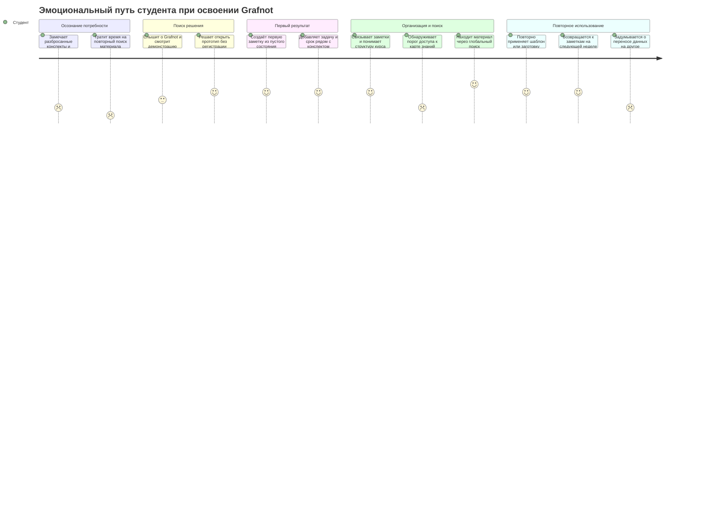

# Journey Map — Grafnot

**Сценарий:** студенту нужно собрать учебные заметки, задачи и связи между темами в одном месте — и быстро возвращаться к ним в течение семестра.

> **Статус карты:** рабочая гипотеза по целевой аудитории и текущему прототипу, а не результат проведённого юзабилити-исследования. Оценки эмоций и внешние каналы привлечения нужно проверить с пользователями.

## Персона

**Персона (primary, из Lab3 без изменений):** Аружан Серикова, 19 — 2 курс Information Systems, IITU; phone-first, RU/KZ. Хочет находить конспекты за секунды в офлайн-приложении без мануала.

## Сценарий (формат Task 1)

- **Персона:** Аружан Серикова, 19 (primary persona из Lab3).
- **Сценарий:** вечером перед экзаменом по СУБД Аружан ищет конспект по нормализации, связывает его с темой транзакций и сохраняет план повторения.
- **Цель пользователя:** найти материал за секунды и зафиксировать связанный план повторения в одном месте.
- **Ожидаемый результат:** заметка открыта через поиск, создана связь с «Транзакциями», задача повторения со сроком сохранена локально.

- **Цели:** быстро записывать материал с занятий; не забывать задания и сроки; связывать темы и находить нужную заметку перед экзаменом.
- **Ожидания:** начать без регистрации и сложной настройки; писать в привычном визуальном редакторе; пользоваться заметками, задачами и календарём в одном месте; понимать, где хранятся данные.
- **Контекст:** переключается между занятиями, LMS, чатами и личными файлами; работает с телефона или ноутбука; может заниматься без стабильного интернета.
- **Критерий успеха:** первая заметка, задача и связь между заметками появляются без инструкции, а нужный материал находится при следующем обращении.

## Эмоциональная кривая

Оценка от **1** (сильное затруднение) до **5** (восторг). Просадка показывает места, которые стоит проверить в тестировании.

## Крайние точки кривой (для Task 3 и защиты)

- **Lowest — 1: «Тратит время на повторный поиск материала» (этап осознания, до продукта).** Конспекты разбросаны по чатам, LMS и файлам; каждая сессия начинается с потери контекста. Это боль, ради которой существует продукт.
- **Самая низкая точка внутри продукта — 2 (две): порог карты в 20 заметок и тревога переноса данных.** Первая выглядит как баг или пейволл без объяснения; вторая — следствие local-first без бэкапа. Обе — главные кандидаты в T5-улучшения.
- **Highest — 5: «Находит материал через глобальный поиск».** Первый момент, когда система возвращает ценность быстрее, чем ручной поиск: Ctrl+K, 2–3 буквы, Enter — заметка открыта. Это пик, который надо защищать и усиливать.

## Путь по этапам

|  | 1. Возникновение потребности | 2. Поиск и решение попробовать | 3. Первый запуск | 4. Учёба и планирование | 5. Организация и поиск | 6. Возврат и регулярное использование |
|---|---|---|---|---|---|---|
| **Действия** | Замечает, что конспекты, сроки и материалы курса разбросаны по чатам, LMS и файлам. | Сравнивает привычный блокнот с новым инструментом; открывает ссылку на демо или прототип. | Осматривает пустое состояние, выбирает язык при необходимости, создаёт первую заметку. | Пишет конспект, добавляет задачу со сроком, связывает заметки по теме. | Ищет через Ctrl+K, открывает связи, календарь или карту знаний. | Возвращается к курсу, использует шаблоны/заготовки, экспортирует нужную заметку, может посоветовать инструмент одногруппнику. |
| **Мысли и ожидания** | «Где последняя версия конспекта? Что нужно сдать на этой неделе?» | «Это проще, чем настраивать новую систему? Данные останутся моими?» | «Можно просто открыть и начать писать?» | «Хочу держать материал и следующее действие рядом». | «Нужно быстро найти тему и понять, с чем она связана». | «Продолжу с того же места. А как перенести всё на другой ноутбук?» |
| **Эмоции, 1–5** | **2** — раздражение и тревога из-за потери контекста. | **3** — интерес смешан с сомнением. | **4** — облегчение, если первый шаг очевиден. | **4** — ощущение порядка и контроля. | **2–5** — карта может удивить порогом в 20 заметок; успешный поиск даёт быстрый выигрыш. | **2–4** — привычка формируется, но отсутствие синхронизации/полной резервной копии вызывает беспокойство. |
| **Точки контакта** | LMS, групповые чаты, папки с файлами, бумажный блокнот. | Ссылка от одногруппника или преподавателя, презентация/демо, README проекта. Внешние каналы — гипотеза, не функция приложения. | Экран пустого состояния, подсказка, кнопка создания заметки, настройки языка, статус локального сохранения. | Редактор заметки, панель задач, диалог срока, календарь, кнопка связи заметок. | Ctrl+K, список заметок, результаты поиска, двусторонние ссылки, карта знаний с порогом доступа. | Локальный `localStorage`, статус «Сохранено локально», экспорт заметки в Markdown, экран промптов и шаблонов. |
| **Барьеры и боли** | Материалы дублируются; дедлайн можно пропустить; связи между темами не видны. | Без короткой демонстрации ценность неочевидна; пользователь может опасаться неизвестного способа хранения данных. | Пустая система всё ещё может казаться сложной, если неясно, что делать после создания заметки. | Переключение между конспектом и планом может прерывать работу; срок задачи нужно не забыть указать. | Карта открывается после 20 заметок; хоткей поиска можно не заметить; новая структура требует привыкания. | Данные привязаны к браузеру и устройству; нет облачной синхронизации и полного экспорта/импорта хранилища. Набор image-тегов — статический семпл. |
| **Идеи для улучшений** | Показать сценарий «конспект → задача → связь» на коротком примере. | Чётко объяснить local-first, отсутствие аккаунта и ограничения прототипа; дать попробовать без оплаты и регистрации. | Добавить необязательный мини-маршрут: создать заметку → добавить задачу → связать тему; не перегружать обязательным туром. | Поддержать быстрое добавление задачи из заметки и подсказку о сроке; сохранить доступность клавиатурных действий. | Объяснить порог карты заранее или показать закрытую карту-превью; заметнее подсветить Ctrl+K и связь между заметками. | Добавить полный экспорт/импорт и напоминание о резервной копии; явно обозначить, что данные хранятся локально, а словарь тегов статический. |

## Приоритеты и проверка гипотез

1. **Первый успех:** проверить, что новый пользователь создаёт первую заметку и первую связь без помощи; целевой ориентир проекта — первая связь менее чем за 2 минуты.
2. **Понимание локального хранения:** спросить, где пользователь ожидает увидеть свои данные после перезапуска и при переходе на другое устройство.
3. **Карта знаний:** проверить, понимает ли пользователь порог в 20 заметок и не принимает ли его за ошибку или платную покупку.
4. **Возврат:** проверить повторный поиск и продолжение работы через несколько дней; оценить, достаточно ли экспорта одной заметки для реального сценария.

Эмоциональные оценки, предполагаемые каналы привлечения и боли нужно валидировать интервью и модерируемыми заданиями. В текущем прототипе нет оформления покупки, маркетингового сайта, аналитики использования или облачной синхронизации; этап «покупка» поэтому представлен как **решение попробовать и открыть прототип**.
