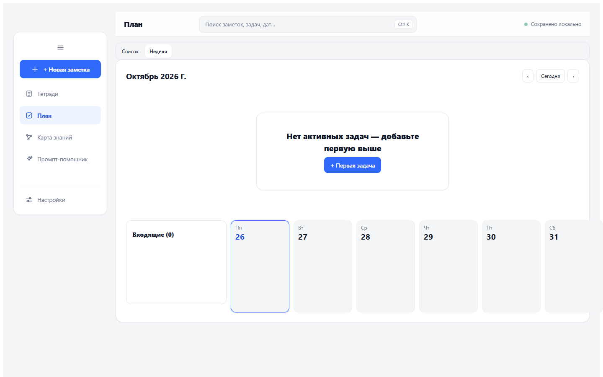

# Grafnot — углублённая проверка работоспособности

Дата: 26 октября 2026 года. Среда: Windows, локальная production-сборка Vite, системный Chrome через Playwright. Все данные создавались в изолированных браузерных контекстах; пользовательские профили не использовались.

Исходники и тесты не изменялись: SHA-256 проверены для 907 файлов, изменений 0. Сборка обновляла только игнорируемый dist. Исправления по результатам этого этапа не выполнялись.

## Результат

Подтверждены **9 дефектов: 2 P1 и 7 P2**. Основной риск — потеря доступности профилей из-за перезаписи реестра. Файлы данных в этих сценариях остаются в localStorage, но профиль исчезает из штатного выбора. Это не утверждение о физическом удалении всех заметок.

P1 — приоритетное исправление сохранности и доступности данных. P2 — последующее исправление поведения, интерфейса или проверки качества. Приоритеты являются оценкой по воспроизведённым последствиям.

## Подтверждённые дефекты

### F1. P1 — вкладки перезаписывают реестр устаревшей копией

**Актуализация 27.10.2026: F1 исправлен.** Проверки и границы изменения — [Grafnot_F1_Fix.md](./Grafnot_F1_Fix.md). Описание ниже фиксирует исходное состояние на момент аудита. F2 исправлен следующим этапом: [Grafnot_F2_Fix.md](./Grafnot_F2_Fix.md). Статусы F3–F9 пока не пересматривались.

**Условия:** две вкладки открыты до изменения списка профилей.

**Шаги:**

1. В обеих вкладках открыть профиль One.
2. Во вкладке A создать профиль Parallel A, создать в нём заметку и дождаться записи.
3. Во вкладке B создать профиль Parallel B.

**Ожидание:** оба новых профиля остаются доступны; конфликт реестра обнаруживается или операция учитывает актуальный реестр.

**Факт:** реестр содержит только One и Parallel B. Запись данных Parallel A существует, но профиль исчез из выбора.

**Дополнительное воспроизведение:** удалить p2 во вкладке A, затем войти в p1 из старого списка вкладки B. p2 возвращается в реестр, хотя его данные уже удалены. Возникает пустой профиль вместо ранее удалённого.

**Причина по коду:** обработчик storage следит только за ключом активного стора; сохранение реестра не сравнивает его с актуальной версией в хранилище. [src/App.tsx:409](D:/Opencode/HumanAComputer/grafnot-prototype/src/App.tsx:409), [src/App.tsx:570](D:/Opencode/HumanAComputer/grafnot-prototype/src/App.tsx:570), [src/App.tsx:602](D:/Opencode/HumanAComputer/grafnot-prototype/src/App.tsx:602).

### F2. P1 — временная ошибка чтения реестра уничтожает его состав

**Актуализация 27.10.2026: F2 исправлен.** Проверки и границы изменения — [Grafnot_F2_Fix.md](./Grafnot_F2_Fix.md). Описание ниже фиксирует исходное состояние на момент аудита.

**Условия:** первое getItem для grafnot-profiles-v1 выбрасывает SecurityError, следующие чтения и записи доступны. Исходно существуют профили p1 и p2.

**Шаги:** запустить приложение с таким отказом одного чтения.

**Ожидание:** блокировка с повтором чтения; существующий реестр не заменяется новым.

**Факт:** сохранён новый реестр с одним профилем pf…; p1 и p2 исчезли из выбора. Их отдельные сторы сохранились. Блокирующий экран не появился.

**Причина по коду:** исключение чтения при raw=null классифицируется как absent; ветка первого запуска создаёт новый реестр. [src/profiles.ts:127](D:/Opencode/HumanAComputer/grafnot-prototype/src/profiles.ts:127), [src/storage/profileBoot.ts:125](D:/Opencode/HumanAComputer/grafnot-prototype/src/storage/profileBoot.ts:125), [src/storage/profileBoot.ts:196](D:/Opencode/HumanAComputer/grafnot-prototype/src/storage/profileBoot.ts:196).

### F3. P2 — полный запрет localStorage приводит к пустому экрану

**Условия:** само обращение к window.localStorage выбрасывает SecurityError.

**Шаги:** запустить приложение при запрещённом доступе к хранилищу.

**Ожидание:** сообщение о недоступности данных и возможность повторить попытку.

**Факт:** исключение Storage blocked; у #root ноль дочерних элементов, body пустой. Защита loadProfileStore не достигается, поскольку ошибка происходит раньше, при инициализации реестра.

**Код:** [src/storage/profileBoot.ts:159](D:/Opencode/HumanAComputer/grafnot-prototype/src/storage/profileBoot.ts:159), [src/main.tsx:25](D:/Opencode/HumanAComputer/grafnot-prototype/src/main.tsx:25). ErrorBoundary внутри App не охватывает исключение до возврата JSX из App.

### F4. P2 — перенос настроек не завершается после прерывания или частичного отказа

**Сценарий A:** сохранены валидный реестр и копия стора; остались grafnot-adoption-pending-v1, legacy-стор и голые настройки theme=dark, lang=EN — состояние прерывания после записи реестра, перед переносом настроек.

**Ожидание:** незавершённая миграция продолжается при следующем запуске.

**Факт:** ранний выход по валидному реестру пропускает её. Интерфейс светлый, профиль получает theme=light; исходное bare theme=dark остаётся. Служебный ключ и legacy-стор тоже остаются.

**Сценарий B:** запись реестра и стора доступна, но запись grafnot-theme:<id> отклоняется.

**Факт:** приложение открывается со светлой темой без блокировки. Исходная настройка dark остаётся под bare-ключом, legacy-стор удалён, автоматического повтора переноса настройки нет. Исходное значение не уничтожено, но штатный профиль его не использует.

**Код:** ранний выход [src/storage/profileBoot.ts:126](D:/Opencode/HumanAComputer/grafnot-prototype/src/storage/profileBoot.ts:126); порядок записи и очистки [src/storage/profileBoot.ts:175](D:/Opencode/HumanAComputer/grafnot-prototype/src/storage/profileBoot.ts:175); поглощение ошибок копирования [src/prefs.ts:51](D:/Opencode/HumanAComputer/grafnot-prototype/src/prefs.ts:51).

### F5. P2 — неизвестное JSON-поле __proto__ всё ещё теряется

**Условия:** валидный JSON текущей схемы содержит собственный ключ __proto__ с объектом; рядом есть normalExtra.

**Шаги:** загрузить профиль, изменить заголовок с подтверждением Enter, дождаться записи.

**Ожидание:** оба неизвестных поля сохраняются как обычные поля JSON.

**Факт:** normalExtra сохранён, Object.hasOwn(записанныйОбъект, '__proto__') возвращает false.

**Причина:** rest создаётся обычным объектом; присваивание rest[k] для __proto__ меняет его прототип вместо добавления собственного поля. Это локальная потеря поля, а не доказательство глобального prototype pollution. [src/store.ts:371](D:/Opencode/HumanAComputer/grafnot-prototype/src/store.ts:371).

### F6. P2 — очистка хранилища в другой вкладке оставляет ложный статус сохранения

**Шаги:** открыть один профиль в двух вкладках, дождаться покоя; во второй выполнить localStorage.clear().

**Ожидание:** первая вкладка сообщает об удалении данных или конфликте и перестаёт утверждать, что её версия сохранена.

**Факт:** ключ стора отсутствует, прежняя заметка остаётся на экране, статус — «Сохранено локально», блокировки нет.

**Причина:** storage-событие от clear() имеет key=null и отбрасывается сравнением с ключом активного стора. [src/App.tsx:409](D:/Opencode/HumanAComputer/grafnot-prototype/src/App.tsx:409).

### F7. P2 — скрипт матрицы дат допускает ложный зелёный результат

**Воспроизведение с внедрением отказа:** дочерний spawnSync возвращает status=2, stderr='FATAL browser unavailable', stdout пустой.

**Ожидание:** матрица завершается ненулевым кодом и сообщает о неисполненных тестах.

**Факт:** все 12 строк помечены GREEN, итог MATRIX: all green, exit=0.

**Причина:** успех определяется только отсутствием строк, начинающихся с FAIL; status, error и наличие полного отчёта не проверяются. [scripts/e2e-weekday-matrix.cjs:25](D:/Opencode/HumanAComputer/grafnot-prototype/scripts/e2e-weekday-matrix.cjs:25).

Этот дефект воспроизведён на подставном результате запуска. Реальные дополнительные прогоны дат выполнены отдельным временным оркестратором, который проверял exit=0 и точный итог 12/12.

### F8. P2 — недельный планировщик выходит за экран desktop

**Шаги:** viewport 1440×900, раскрытая навигация, открыть #/plan/week. Дефект есть даже без задач.

**Ожидание:** семь дней доступны внутри рабочей области; горизонтальная прокрутка, если нужна, принадлежит самой сетке.

**Факт:** document.scrollWidth=1591 при innerWidth=1440; правый край последнего дня x=1591. Воскресенье находится за видимой областью. В матрице это повторилось во всех 6 сочетаниях темы и языка на desktop; на трёх проверенных мобильных размерах внешнего горизонтального выхода не найдено.

**Причина:** сетка требует 240 + 7×140 + 7×10 = 1290 px при доступной ширине 1082 px; собственного ограничения/горизонтального контейнера нет. [src/index.css:414](D:/Opencode/HumanAComputer/grafnot-prototype/src/index.css:414).

### F9. P2 — заголовок заметки теряется при закрытии вкладки до blur/Enter

**Шаги:** открыть заметку Original title; ввести Title typed before close в поле заголовка; не нажимать Enter и не переводить фокус; закрыть вкладку с обычным beforeunload, затем открыть приложение снова.

**Ожидание:** сохранение введённого заголовка либо явное предупреждение о несохранённом черновике.

**Факт:** перед закрытием статус «Сохранено локально»; после открытия заголовок Original title. Новый ввод исчез.

**Причина:** onChange меняет только локальный draft; запись в общий стор происходит на blur или Enter. Черновик не входит в состояние автосохранения. [src/NotesView.tsx:292](D:/Opencode/HumanAComputer/grafnot-prototype/src/NotesView.tsx:292), [src/NotesView.tsx:715](D:/Opencode/HumanAComputer/grafnot-prototype/src/NotesView.tsx:715).

**Контрольный сценарий:** ввод тела заметки с немедленным закрытием сохранился — Body typed before immediate close прочитан из стора после повторного открытия.

## Что проверено и что прошло

| Область | Проверка и результат |
|---|---|
| Базовая регрессия | На неизменённом коде этапа 3 уже пройдены 286/286 unit, 171/171 E2E, TypeScript, oxlint, i18n + selftest, контраст и синхронизация README. На этом этапе они повторно целиком не запускались. |
| Данные и профили | Дополнительные отказы чтения/записи, прерывание миграции, конкурирующие вкладки, удаление и очистка. Найдены F1–F6. Стандартные квота, битый JSON, будущая схема, backup и экспорт входят в базовую регрессию. |
| Заметки | Базовая регрессия: создание, редактирование, ссылки, выделение→задача, Undo/корзина, экспорт. Дополнительно немедленное закрытие: тело сохранено, заголовок — F9. |
| Планировщик | 4 реальных прогона по 12 проверок: 26.10.2026, 31.12.2026, 03.01.2027, 29.02.2028 — 48/48. Проверены список/неделя, группы, ввод, перенос, Undo, входящие и навигация. Desktop-раскладка — F8. |
| Промпты | Базовая регрессия покрывает библиотеку, текстовую рабочую область, обязательные поля, превью, копирование, сохранение/привязку, image-теги и builder. Дополнительно проверены раскладки библиотеки, текстового шаблона и builder во всех 24 окружениях. |
| Карта | Базовая регрессия: поиск, связи/Undo, состав, удаление графа, сироты, drag/zoom. Дополнительно раскладки и замеры 100/1000/5000 узлов. |
| Навигация | Базовая регрессия: Back/Forward, deep links, палитра и реестр клавиш. Дополнительно 6 некорректных маршрутов notes/map/prompts/settings/plan/unknown: непустой интерфейс, без pageerror; смысл выбранного fallback отдельно не оценивался. |
| Темы, языки, адаптивность | 4 viewport × 2 темы × RU/EN/KZ × 10 маршрутов = 240 осмотров. 6 осмотров с горизонтальным overflow одного маршрута desktop; остальные 234 без такого выхода. Во всех осмотрах нет pageerror, непредвиденного экрана блокировки или видимых кнопок без текста/aria-label/title. |
| Цели взаимодействия | audit-targets enforce: 2 viewport, 12 страниц, 420 элементов, 0 нарушений, 13 исключений по существующему allowlist. Исключения не пересматривались; полный WCAG-аудит не выполнялся. |
| Чистота CSS | check-css-unused: 85 определённых .g-классов, 0 неиспользуемых. |

Матрица раскладок: 1440×900, 390×844, 360×740, 844×390; обе темы; RU/EN/KZ. Маршруты: список/редактор заметок, список/неделя плана, карта, библиотека/текстовая рабочая область/редактор шаблона, внешний вид и клавиши настроек.

## Производительность

Единичные локальные измерения production-сборки в Chrome без CPU throttling. Это ориентир для данного компьютера, не статистический бенчмарк и не прогноз для телефона. Notes-наборы дополнительно содержали 1000 задач. Время открытия включает переход и ожидание появления рабочего элемента; setItem измерялся отдельно и не включает JSON.stringify.

| Экран | Заметок/узлов | Открытие, мс | Синхронный setItem, мс | Дополнительно |
|---|---:|---:|---:|---|
| notes | 100 | 437 | 0.2 | видимых строк 50; max long task 0 мс |
| notes | 1000 | 428 | 0.4 | видимых строк 50; max long task 0 мс |
| notes | 5000 | 462 | 1.1 | видимых строк 50; max long task 71 мс |
| notes | 10000 | 557 | 3.9 | видимых строк 50; max long task 153 мс |
| map | 100 | 514 | — | SVG-групп 101 |
| map | 1000 | 1471 | — | SVG-групп 1001 |
| map | 5000 | 8764 | — | SVG-групп 5001 |

Список ограничивает первоначальный DOM 50 строками. На 10 000 заметок наблюдались отдельные long tasks до 153 мс. Карта на 5000 узлов открылась за 8,764 с — существенное ограничение больших графов. В коде выполняются 300 синхронных тиков force-layout ([src/graphLayout.ts:33](D:/Opencode/HumanAComputer/grafnot-prototype/src/graphLayout.ts:33), [src/graphLayout.ts:64](D:/Opencode/HumanAComputer/grafnot-prototype/src/graphLayout.ts:64)); их отдельный вклад в полное время не профилировался.

Вес: total JS gzip 243,5 КБ, initial entry 105,4 КБ; предохранитель относительно baseline пройден. Это JS-отчёт, без CSS и остальных ресурсов.

## Известные ограничения продукта

Уже зафиксированы в README: нет истории версий заметок; нет единого импорта/экспорта всей рабочей области; нет автоматической очистки корзины через 30 дней; конфликт содержимого решается выбором версии без слияния. Они отделены от новых дефектов и не считаются вновь обнаруженными поломками.

## Непроверенное

- Реальные мобильные устройства, экранная клавиатура, IME и системные жесты; эмуляция viewport и touch их не заменяет.
- Firefox/Safari, отдельные режимы приватности и политики удаления данных браузерами.
- Screen reader, полный аудит WCAG, все пары цветов и все состояния вложенных попапов.
- Принудительное завершение процесса/потеря питания; прерванная миграция проверялась подготовкой соответствующего состояния хранилища.
- Все комбинации повреждённых полей и дубликатов ID; проверка не является исчерпывающим fuzzing или аудитом безопасности.
- Серия замеров производительности, профилирование CPU, слабые устройства и длительный soak-test.
- Реальный GitHub Actions запуск. Дефект матрицы F7 воспроизведён внедрением результата аварийного дочернего запуска.

## Следующий порядок исправлений

1. F1–F2: сериализация/контроль конфликтов реестра, явная ошибка его чтения, сохранение состава профилей.
2. F9 и F4: включить незавершённый ввод заголовка в защиту сохранения; продолжать незавершённую миграцию настроек.
3. F3, F5, F6: экран ошибки ранней загрузки, безопасное хранение произвольных JSON-ключей, обработка clear().
4. F7–F8: надёжность матрицы тестов и ширина недельной сетки.
5. Отдельно оценить целевой масштаб графа и необходимость переноса тяжёлого layout из основного потока.

Этот список — рекомендации. Изменения не выполнялись.
